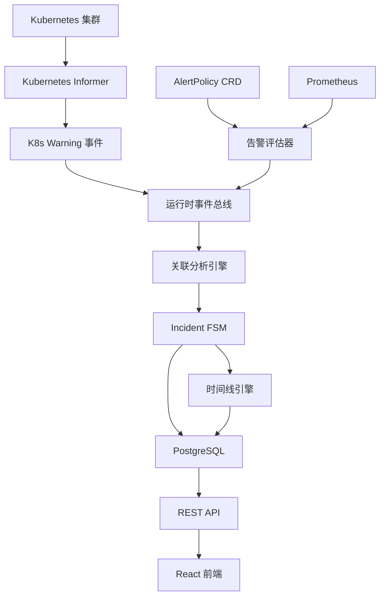
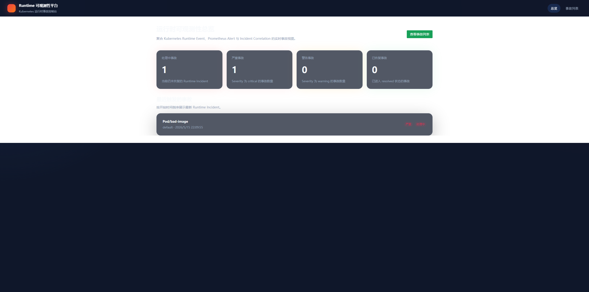
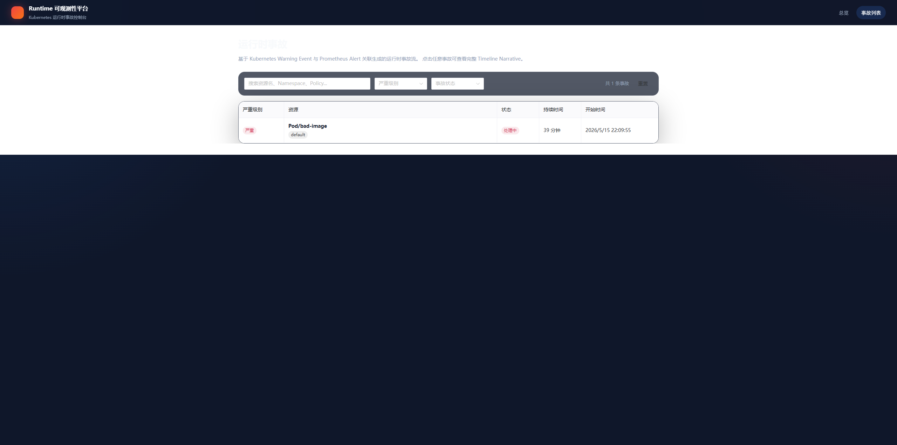
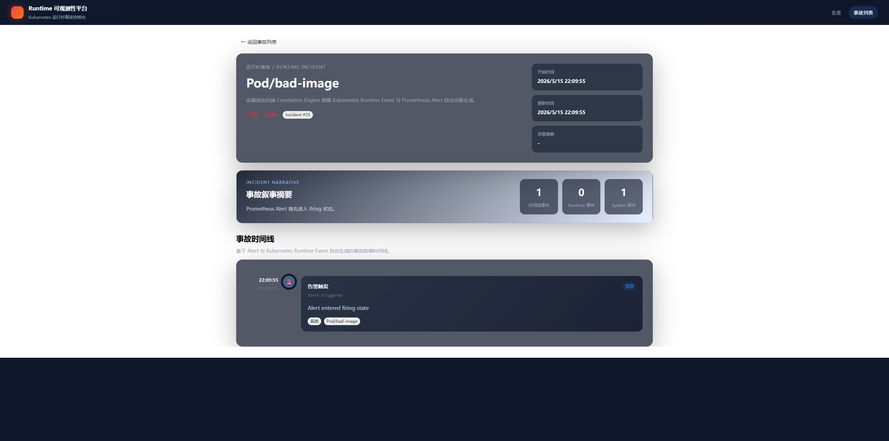

# Kubernetes 运行时事件智能平台

## 项目概述

这是一个基于 Kubernetes 原生架构构建的运行时事件智能平台（Runtime Incident Intelligence Platform），采用了以下核心技术：

- Kubernetes Operator 模式
- client-go / controller-runtime
- 事件驱动运行时关联分析
- Incident 生命周期有限状态机（FSM）
- 运行时时间线叙事系统（Timeline Narrative）
- PostgreSQL 持久化存储
- 基于 Prometheus 的告警评估
- React 前端仪表盘

它本质上是一个专注于运行时可观测性的智能平台，目标包括：

- 检测 Kubernetes 运行时故障
- 关联运行时信号
- 管理 Incident 生命周期
- 构建 Incident 时间线叙事
- 提供可视化运维控制台

**当前项目为 MVP（Minimum Viable Product）阶段，**
**重点验证 Kubernetes Runtime Incident Lifecycle 与 Runtime Event Correlation 能力。**

------

# 为什么要做这个项目

传统 Kubernetes 监控工具通常只停留在：

```text
告警已触发（Alert Fired）
```

而本项目进一步实现了：

```text
Kubernetes 运行时信号
    ↓
事件关联分析
    ↓
Incident 生命周期 FSM
    ↓
时间线叙事
    ↓
运维可视化
```

目标是将底层 Kubernetes 运行时事件，转化为结构化的运维 Incident。

------

# 核心功能

## Kubernetes 原生 AlertPolicy CRD

通过自定义 AlertPolicy 资源动态定义运行时告警规则。

示例：

```yaml
apiVersion: observability.io/v1
kind: AlertPolicy

metadata:
  name: bad-image-alert
  namespace: monitoring

spec:
  tenantID: t1

  policyName: bad-image-alert

  query: |
    kube_pod_container_status_waiting_reason{
      namespace="monitoring",
      reason=~"ImagePullBackOff|ErrImagePull"
    }

  threshold: 0

  operator: ">"

  duration: 10s

  severity: critical

  enabled: true
```

------

## 运行时事件总线（Runtime Event Bus）

内部构建了一个事件驱动运行时管道，支持：

- 数据校验（Validation）
- 去重（Deduplication）
- 限流（Rate Limiting）
- 发布/订阅架构（Publish / Subscribe）

运行时事件包括：

- alert.triggered
- alert.resolved
- k8s.warning
- k8s.normal

------

## Kubernetes 运行时事件关联分析

平台会消费以下数据：

- Prometheus 告警信号
- Kubernetes Warning 事件
- 运行时资源元数据

并将它们关联为：

```text
Pod
Deployment
Node
AlertPolicy
Incident
Timeline
```

之间的关系。

------

## Incident 生命周期 FSM

系统实现了一个运行时 Incident 有限状态机：

```text
Open（打开）
  ↓
Resolved（已恢复）
  ↓
Reopened（重新打开 / 抖动检测）
```

功能包括：

- 活跃 Incident 去重
- 抖动窗口检测（Flapping Detection）
- Incident 重开
- 运行时事件挂载
- 时间线持久化

------

## 时间线叙事引擎（Timeline Narrative Engine）

每个 Incident 都维护一条运行时时间线。

示例：

```text
10:01 告警触发
10:01 ImagePullBackOff
10:02 FailedScheduling
10:03 容器重启
10:05 Incident 已恢复
```

这使系统不仅仅是孤立告警，而是能够形成完整的运维上下文。

------

## 前端仪表盘

前端提供：

- Incident 列表
- 严重级别过滤
- Incident 详情页
- 运行时时间线可视化
- 实时 Incident 状态更新

------

# 系统架构



------

# 运行时流程

## 示例：镜像错误 Incident

```text
Deployment 创建
    ↓
ImagePullBackOff
    ↓
Prometheus 指标触发
    ↓
AlertPolicy 评估
    ↓
生成 alert.triggered 运行时事件
    ↓
关联分析引擎
    ↓
Incident FSM 打开 Incident
    ↓
追加时间线
    ↓
前端可视化展示
```

------

# 技术栈

## 后端

- Golang
- client-go
- controller-runtime
- Kubernetes Informers
- PostgreSQL
- Prometheus
- REST API

## 前端

- React
- TypeScript
- TailwindCSS
- Axios

## 基础设施

- Kubernetes
- Docker
- Prometheus Stack

------

# 项目结构

```text
internal/
├── operator/
├── runtime/
│   ├── correlation/
│   ├── event/
│   ├── incidentfsm/
│   ├── timeline/
│   └── graph/
├── repository/
├── api/
└── server/
```

------

# 支持的运行时场景

## 当前已验证场景（Validated Runtime Scenarios）

### ImagePullBackOff / ErrImagePull

当前 MVP 已完整验证以下运行时场景：

- ImagePullBackOff
- ErrImagePull

系统能够完成：

```
Runtime Signal
    ↓
AlertPolicy Evaluation
    ↓
Runtime Event
    ↓
Incident FSM
    ↓
Timeline Narrative
    ↓
Frontend Visualization
```

完整运行时链路。

包括：

- Prometheus 指标检测
- Kubernetes Warning Event
- Runtime Event Correlation
- Incident 自动创建
- Timeline 持久化
- 前端 Incident 展示

------

## 架构可扩展场景（Framework Extensible Scenarios）

当前 Runtime Pipeline 已抽象为通用 Incident Correlation Framework。

理论上可扩展支持：

### CrashLoopBackOff

- 容器持续崩溃
- Restart Loop
- Runtime Restart Correlation

------

### FailedScheduling

- 资源不足
- Pod Pending
- Scheduling Failure

------

### Pod Restart Anomaly

- 容器频繁重启
- Runtime Stability Analysis

------

### Node Runtime Failure

- Node NotReady
- kubelet 不可用
- Node Runtime Incident

------

新增 Runtime Scenario 仅需：

```
新增 AlertPolicy
+ Runtime Correlation Rule
```

即可接入现有 Runtime Incident Pipeline。

------

# 示例演示流程

## 1. 部署错误镜像工作负载

```bash
kubectl apply -f examples/bad-image.yaml
```

## 2. AlertPolicy 检测到运行时故障

```text
ImagePullBackOff
```

## 3. 自动创建 Incident

```text
INCIDENT FSM: created incident=1
```

## 4. 时间线事件挂载

```text
alert.triggered
k8s.warning
```

## 5. 前端展示运行时 Incident

------

# 项目展示的关键工程能力

本项目展示了：

- Kubernetes Operator 模式
- client-go Informers
- 事件驱动架构
- 运行时信号关联分析
- Incident 生命周期管理
- 有限状态机设计
- 时间线叙事建模
- Kubernetes 原生资源建模
- 运行时可观测性工程
- 平台工程设计理念

------

# 未来改进方向

未来可扩展：

- 多集群支持
- 分布式事件流
- 基于图的运行时依赖分析
- AI 辅助 Incident 摘要生成
- Slack / PagerDuty 集成
- Leader Election
- Status Subresource 支持
- Kubernetes Conditions 支持

------

# 截图

### 总览



### Incident 列表



### Incident 详情页




------

# 如何运行

## 后端

```bash
make run
```

## 前端

```bash
cd frontend
npm install
npm run dev
```

## 应用 Alert Policies

```bash
kubectl apply -f deploy/alert-policy/
```

